# 手雷
	- ## 警家丢
	  collapsed:: true
		- 投掷：W跑半步左键跳投
		- 站位：CT墙和窗户的左边平齐
			- 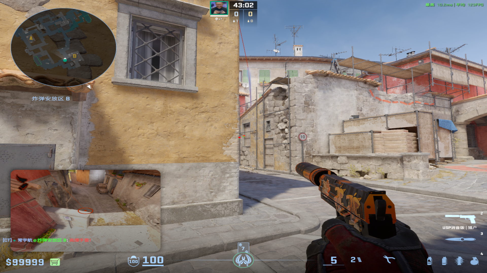{:height 308, :width 533}
		- 描点：小黄长方形的左中部分
			- 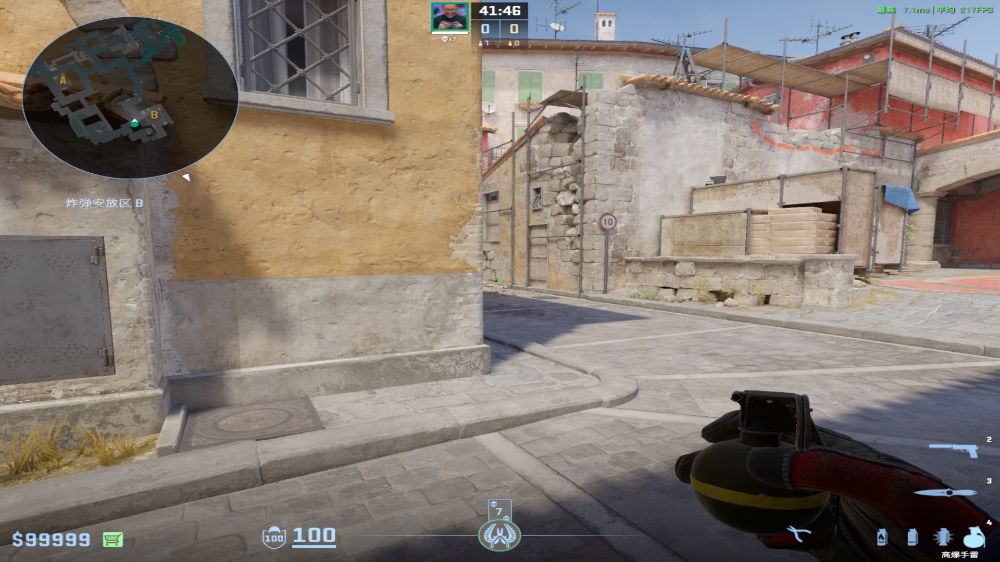
			-
	-
	- ## 二箱丢
	  collapsed:: true
		- 投掷：左键跳投
		- 站位：向下拉到和小斜树叶平齐
			- 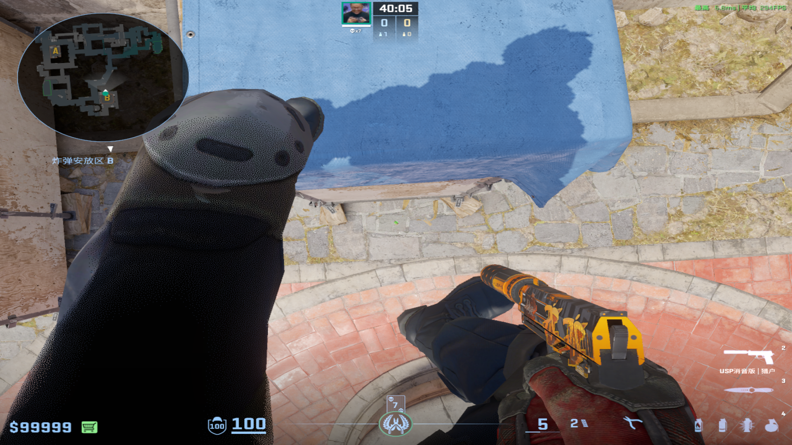
		- 描点：和二箱最大缝隙向上平移到一个凹进去的污渍
			- 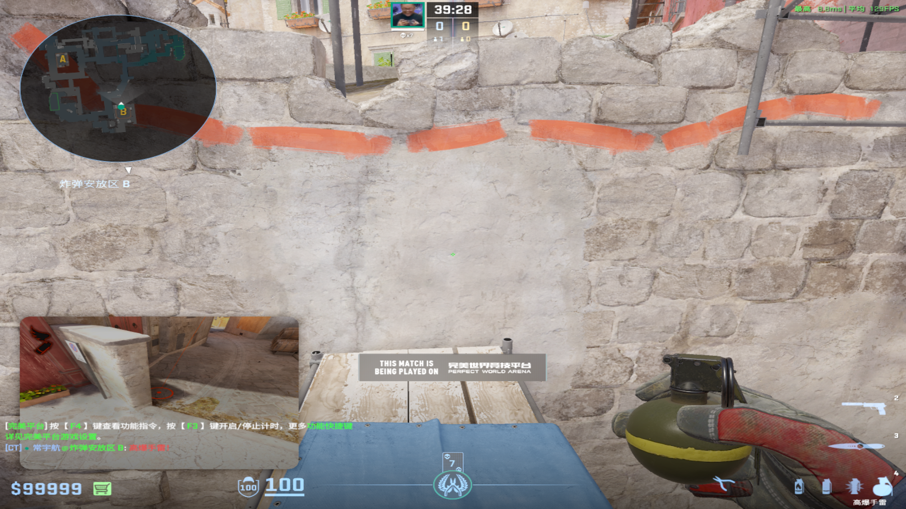
			-
		- 备注：同样丢法——对准二箱左下角的方框右下角，后蹲着找水滴左下角，后站起来左键跳投
			- 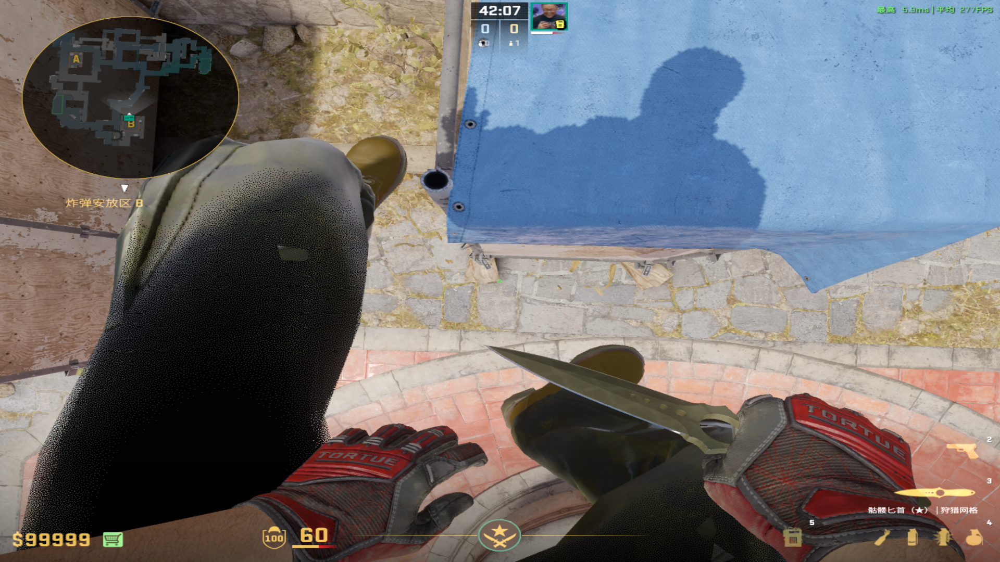
			- 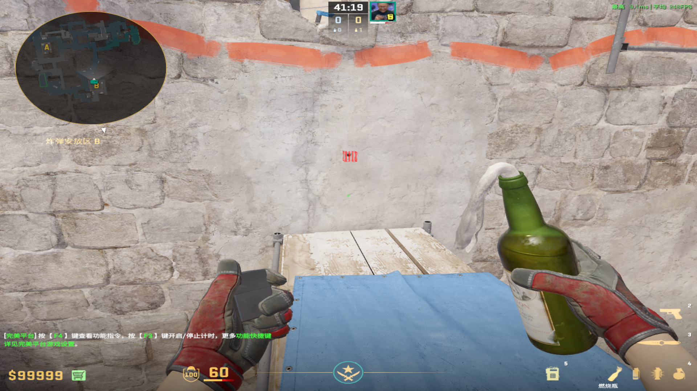
	-
	- ## 棺材丢
	  collapsed:: true
		- 投掷：W跑到台阶处左键跳投
		- 站位：棺材箱子前
		- 描点：红色条纹左下
			- 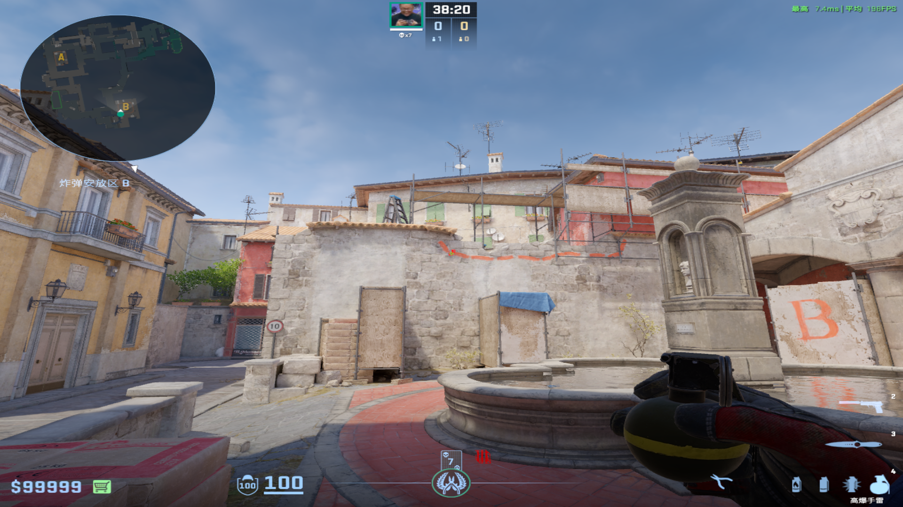
			-
-
- # 闪光弹
	- ## 黄墙反清闪
		- ### CT丢
		  collapsed:: true
			- 投掷：W+双键跳投
			- 站位：CT经典裂缝&水管窗户位
			- 描点：黑色左下角，砖块左上角
				- 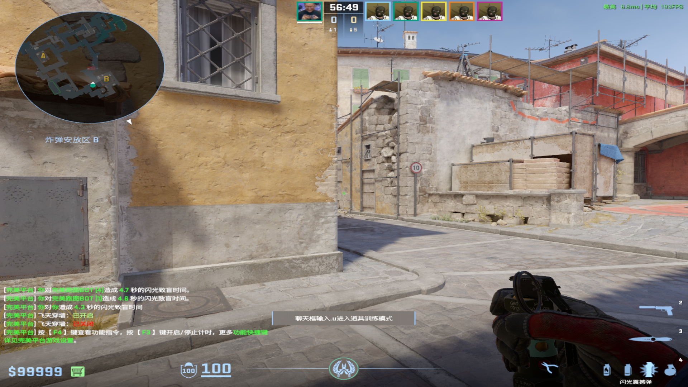{:height 291, :width 503}
				-
		-
		- ### 棺材丢
		  collapsed:: true
			- 投掷：左键直接丢
			- 站位：棺材箱子上
			- 描点：左上角烟囱中间
				- 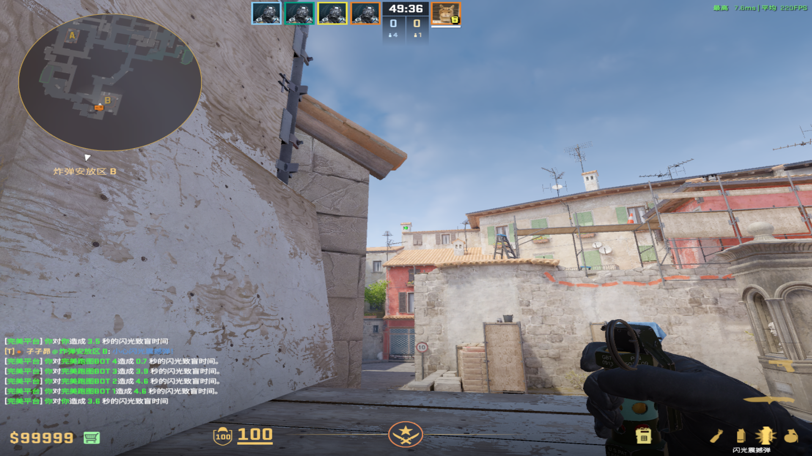
				-
	-
	- ## 石板反清闪
		- ### CT丢
		  collapsed:: true
			- 投掷：左键直接丢
			- 站位：经典位置
			- 描点：烟囱右上角
				- 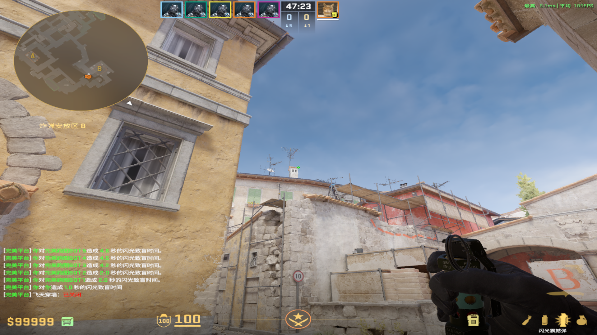
				-
		-
		- ### 台下丢
		  collapsed:: true
			- 投掷：左键直接丢
			- 站位：台下右手死角
			- 描点：卫星锅
				- 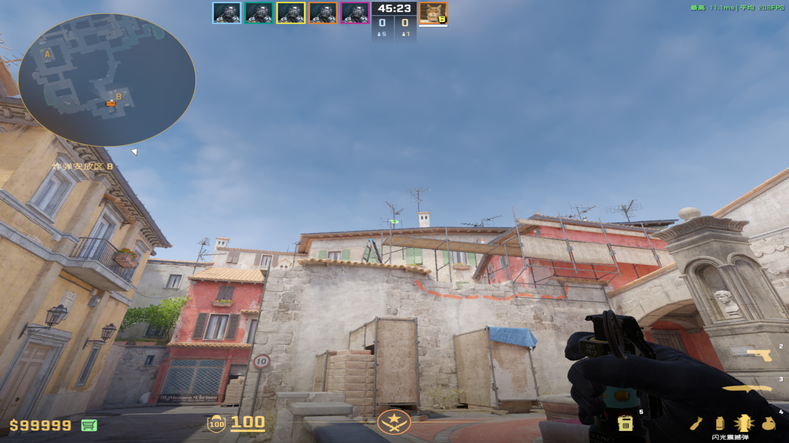
		-
		- ### 棺材丢
		  collapsed:: true
			- 投掷：左键跳投
			- 站位：棺材箱子
			- 描点：最深的砖块角落
				- 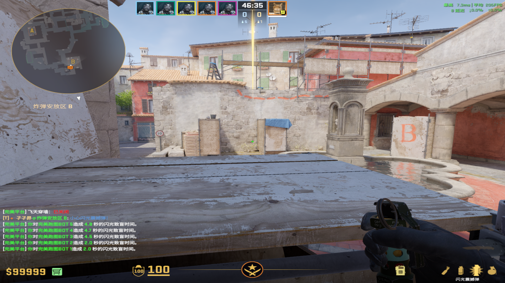
				-
		-
-
- # 烟雾弹
  collapsed:: true
	- ## 摩托丢黄墙隔断烟
	  collapsed:: true
		- 投掷：左键跳投
		- 描点：窗户右下角右侧的黑色方块的左下角
			- 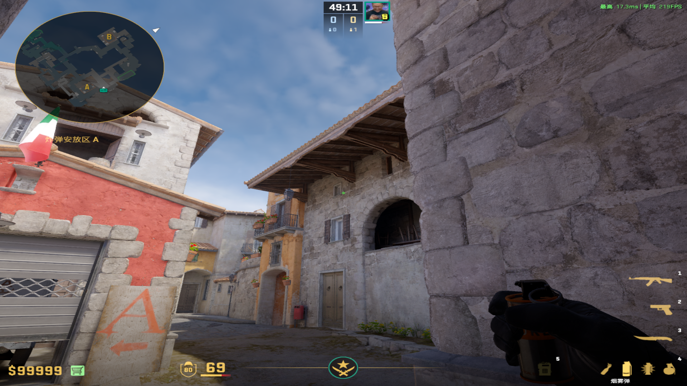
			-
		-